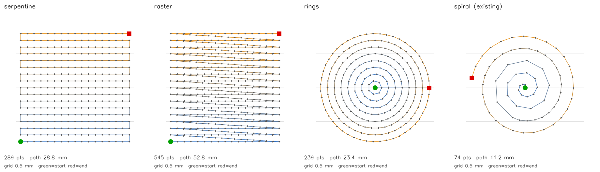
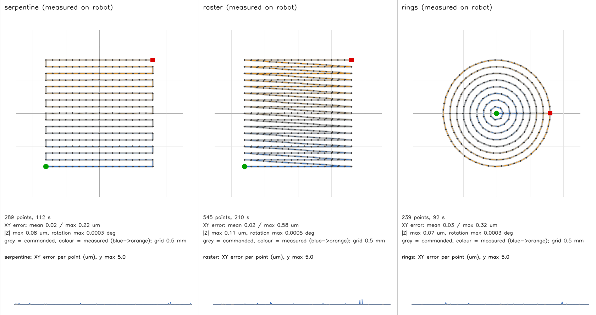

# Alternative mosaic scans

## Run each scan separately

After installing this checkout (`python -m pip install -e ".[dev]"`), each scan
has its own script and CLI command. From the repository root:

```bash
python mosaicking/mosaic_serpentine.py --width-um 1600 --height-um 1200 --spacing-um 100
python mosaicking/mosaic_raster.py --width-um 1600 --height-um 1200 --spacing-um 100
python mosaicking/mosaic_rings.py --radius-um 800 --spacing-um 100
```

Equivalent commands are `smarpod-pcle mosaic-serpentine`,
`smarpod-pcle mosaic-raster` and `smarpod-pcle mosaic-rings`.
All accept `--dry-run` and `--regression`. For a custom configuration path use
`smarpod-pcle --config PATH mosaic-rings ...` or set `SMARPOD_PCLE_CONFIG` when
using the standalone scripts. Without `--dry-run`, these commands move hardware.
The independent entries share implementation rather than copying the hardware lifecycle.

## Shared selector (optional)

`mosaic-scan` runs alternative XY paths through the existing spiral mosaic's
capture, placement, blending, saving and shutdown lifecycle. Existing spiral
commands retain their defaults.

Preview JSON coordinates without hardware, screenshots or network:

```bash
smarpod-pcle mosaic-scan --pattern serpentine --width-um 1600 --height-um 1200 --spacing-um 100 --dry-run
```

Run on the configured control computer:

```bash
smarpod-pcle --config config/local.toml mosaic-scan --pattern serpentine --width-um 1600 --height-um 1200 --spacing-um 100
smarpod-pcle --config config/local.toml mosaic-scan --pattern raster --width-um 1600 --height-um 1200 --spacing-um 100
smarpod-pcle --config config/local.toml mosaic-scan --pattern rings --radius-um 800 --spacing-um 100
```

Add `--regression` for the existing server displacement backend and commanded
displacement fallback. The default uses commanded positions and calibrated pixel scale.

| Pattern | Behavior |
| --- | --- |
| `serpentine` (default) | Centered rectangular grid, alternating row direction |
| `raster` | Same-direction rows; return diagonals are subdivided and captured |
| `rings` | Origin first, then closed circles with increasing radius |

Width/height default to 1600 µm and apply to grids; radius defaults to 800 µm and
applies to rings. Spacing defaults to 100 µm and bounds grid pitch, radial pitch
and ring arc sampling. Endpoints are included, so actual spacing may be smaller.
All dimensions must be finite and positive. More than 100,000 points is rejected
before hardware initialization. There is no new continuous-video acquisition mode.

The existing runner establishes the stage origin and holds Z/rotations at zero.
Spacing bounds exclude initial positioning and final homing; skipped unreachable
points may increase captured-frame separation. Optical overlap depends on the
valid probe footprint; the default spacing is not a calibrated coverage guarantee.

Output directories retain `mosaic_direct_*` / `mosaic_regression_*` names with
`frames/`, `mosaic.png` and `trajectory.json`. `metadata.scan` records the selected
pattern and requested dimensions. Interruption cleanup and fixed-canvas clipping
behavior remain unchanged.

Implementation: [scan_patterns.py](../src/smarpod_pcle/mosaicking/scan_patterns.py),
[shared runner](../src/smarpod_pcle/mosaicking/scan_runner.py), and
[offline tests](../tests/test_scan_patterns.py).
Raster/spiral comparisons appear in [endoscopic mosaic research](https://pmc.ncbi.nlm.nih.gov/articles/PMC11109657/);
these paths are repository-specific implementations, not a reproduction of that
system. Hardware movement and image quality still require acquisition-setup validation.

## Trajectory plots

Planned paths at the default settings (from `--dry-run`), compared with the
existing direct-mode spiral:



Motion-only hardware test on 2026-11-10 (Windows control PC, 2 mm/s, 0.3 s
settle, pose read after each point, no screen capture or server). Grey is the
commanded path; colour is the measured path. All 1,073 points were reachable.
The mean XY error was 0.02-0.03 µm and the maximum was 0.58 µm. The full mosaic
workflow (capture and stitching) has not yet been run on hardware.


